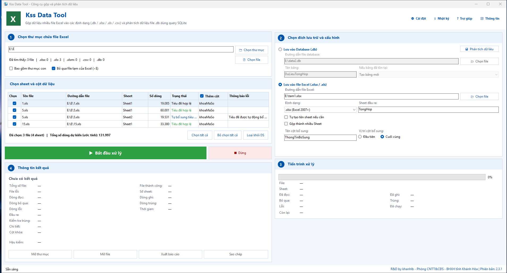

## **Công cụ gộp và phân tích dữ liệu -  KSS DATA TOOL Phiên bản 2.3**

## 1. Giới thiệu

`Kss Data Tool` là ứng dụng chạy trên Hệ điều hành Windows, được thiết kế với các tính năng:

- Gộp dữ liệu một trong 3 loại định dạng `.xlsx / .csv / .db` thành một trong 3 loại dữ liệu là Excel (.xlsx) / SQLite (.db) / CSV File (.csv).
- Đọc dữ liệu từ nhiều Sheet trong nhiều file nguồn *(Hoặc nhiều file dữ liệu nằm trong 1 folder)*.
- Hợp nhất các cột dữ liệu không đồng nhất; cột không có trong tệp nguồn được để trống.
- Kiểm tra và xử lý dữ liệu trùng theo cột khóa.
- Thống kê, truy vấn và phân tích dữ liệu bằng câu lệnh SQL trên SQLite.
- Lưu, nạp và thực thi các chức năng truy vấn/thống kê tùy chỉnh.

## 2. Yêu cầu trước khi sử dụng

1. Sử dụng trên máy tính Windows chạy hệ điều hành Windows đã cài thư viện .NET 8.0 *( Nếu trên máy tính chưa cài hãy [Tải tại đây](https://dotnet.microsoft.com/en-us/download/dotnet/8.0) )*
2. Chuẩn bị các tệp dữ liệu nguồn thuộc định dạng mà phiên bản đang sử dụng hỗ trợ, gồm `.xlsx`, `.xls`, `.db` và `.csv`.
3. Đảm bảo thư mục nguồn có quyền đọc; thư mục đích có quyền ghi.
4. Nên sao lưu dữ liệu nguồn và cơ sở dữ liệu đích (nếu có) trước khi thực hiện gộp hoặc cập nhật dữ liệu.

### 2.1. Lưu ý về dữ liệu

- Kiểm tra tên cột, dòng tiêu đề, định dạng ngày tháng và dữ liệu khóa trước khi gộp.
- Không mở tệp đầu ra bằng ứng dụng khác trong lúc KssDataTool đang ghi dữ liệu.
- Với dữ liệu lớn, nên lưu kết quả vào SQLite (`.db`) để thuận tiện truy vấn và giảm áp lực bộ nhớ so với việc xuất toàn bộ dữ liệu ra Excel.
- Tệp CSV nên sử dụng UTF-8 để hạn chế lỗi tiếng Việt. Khi mở CSV bằng Excel, nếu chữ tiếng Việt hiển thị sai, hãy nhập dữ liệu qua **Data → From Text/CSV** và chọn mã hóa UTF-8.
---

## 3. Giao diện chính – MainForm



Giao diện chính được chia thành bốn khu vực:

### 3.1.1 Khu vực 1 – Chọn thư mục chứa file Excel

- **Chọn thư mục:** Chọn thư mục chứa các tệp dữ liệu nguồn cần gộp.
- **Chọn file:** Chọn một hoặc nhiều tệp riêng lẻ để đưa vào danh sách gộp. Có thể sử dụng thao tác chọn nhiều tệp trong hộp thoại Windows (giữ `Ctrl` hoặc `Shift` khi chọn).
- **Bao gồm thư mục con:** Khi bật, chương trình tìm kiếm tệp trong cả các thư mục con của thư mục đã chọn.
- **Bỏ qua file tạm của Excel (~$):** Khuyến nghị bật để loại trừ tệp tạm do Excel tạo ra.
- **Đã tìm thấy:** Hiển thị tổng số tệp và số lượng theo định dạng được nhận diện.

Sau khi chọn thư mục hoặc tệp, chương trình quét và đưa các tệp phù hợp vào danh sách xử lý.

### 3.1.2. Khu vực chọn Sheet và cột dữ liệu

Bảng danh sách thể hiện thông tin các tệp/Sheet được phát hiện, thường gồm:

| Cột | Ý nghĩa |
|---|---|
| Chọn | Đánh dấu tên tệp/Sheet sẽ tham gia gộp |
| Tên file | Tên tệp nguồn |
| Đường dẫn file | Vị trí tệp nguồn |
| Sheet | Tên Sheet được đọc |
| Số dòng | Số dòng dữ liệu dự kiến |
| Trạng thái | Trạng thái kiểm tra tiêu đề/đọc tệp |
| Thêm cột | Cột tùy chọn -> được `checked` sẽ nhập cho phép chèn thêm cột vào đầu (hoặc cuối) của dữ liệu |
| Thông báo lỗi | Mô tả lỗi nếu tệp hoặc Sheet không xử lý được |

Các nút thao tác:

- **Chọn tất cả:** Đánh dấu toàn bộ mục trong danh sách.
- **Bỏ chọn tất cả:** Bỏ đánh dấu toàn bộ mục.
- **Loại khỏi DS:** Loại mục được chọn khỏi danh sách xử lý.

Phần thông tin phía dưới cho biết số tệp/Sheet đã chọn và tổng số dòng dự kiến.

### 3.3. Khu vực 2 – Chọn đích lưu trữ và cấu hình

Cho phép lựa chọn nơi lưu dữ liệu sau khi gộp:

- **Lưu vào Database (.db):** Lưu dữ liệu vào cơ sở dữ liệu SQLite. Nút **Chọn file** -> Chọn nơi lưu file .db sau khi gộp.
  - Nút **Phân tích dữ liệu**: Mở cửa sổ làm việc với cơ sở dữ liệu SQLite để thực hiện truy vấn và phân tích. Nhấn nút `Chọn file` để chọn đúng file cơ sở dữ liệu .db cần phân tích.
  - *Tên bảng*: Đặt tên bảng sau khi gộp.
  - Nếu bảng đã tồn tại: 
    - *Thêm dữ liệu vào bảng hiện có (Append)*: Nếu bạn chọn 1 file .db đã có trước đó, chức năng này sẽ chèn thêm dữ liệu chuẩn bị gộp vào file .db đó.
    - *Xóa dữ liệu trong bảng rồi nhập lại (Replace Data)*: xóa toàn bộ dữ liệu trong bảng của file .db đã chọn và nhập lại mới.
    - *Tạo bảng mới*: Gộp dữ liệu vào bảng mới.
    - *Tạo bảng với tên khác*: Gộp dữ liệu vào bảng với tên khác không trùng với bảng hiện tại.
- **Lưu vào file Excel (.xlsx / .xls):** Xuất dữ liệu ra tệp Excel theo định dạng được hỗ trợ.
  - *Chọn file*: Chọn nơi lưu file excel sau khi gộp. 
  - *Định dạng*: Xuất dữ liệu ra tệp Excel (.xlsx hoặc .xls) và tệp .csv hỗ trợ UTF-8.
  - *Sheet đầu ra*: Đặt tên sheet của file excel sau khi gộp.
- Có thể bật tùy chọn tự tạo Sheet nếu cần.

### 3.4. Khu vực 3 – Tiến trình xử lý

Trong quá trình gộp, khu vực này hiển thị:

- Thanh tiến trình và tỷ lệ hoàn thành.
- Tệp và Sheet đang xử lý.
- Số dòng đã đọc.
- Số dòng đã ghi.
- Số dòng bỏ qua.
- Số dòng trùng.
- Số lỗi.
- Số lượng còn lại và số mục đã chạy.

**Bắt đầu xử lý:** Khởi chạy quy trình gộp theo các tệp/Sheet đã chọn và cấu hình đầu ra.

**Dừng:** Yêu cầu dừng quy trình đang chạy. Nên chờ chương trình cập nhật trạng thái dừng trước khi đóng ứng dụng hoặc mở tệp đầu ra.

### 3.5. Khu vực 4 – Thông tin kết quả

Sau khi xử lý, khu vực này tổng hợp kết quả, có thể bao gồm:

- Tổng số tệp, số tệp thành công và số tệp lỗi.
- Số Sheet đã xử lý.
- Số dòng đã đọc, đã ghi, bỏ qua, trùng và lỗi.
- Đường dẫn đầu ra.
- Thời gian xử lý.
- Kết quả kiểm tra trùng và thông tin hậu kiểm.

Các nút phía dưới:

- **Mở thư mục:** Mở thư mục chứa kết quả.
- **Mở file:** Mở tệp đầu ra nếu có ứng dụng tương ứng.
- **Xuất báo cáo:** Xuất báo cáo kết quả xử lý nếu chức năng được bật.
- **Sao chép:** Sao chép thông tin kết quả để gửi hoặc lưu lại.

---

## 4. Cấu hình nâng cao


Mở **Cài đặt** trên giao diện chính để thiết lập cách xử lý dữ liệu.

### 4.1. Xử lý trùng lặp

Tùy chọn **Xử lý trùng lặp** quyết định cách chương trình xử lý các dòng trùng. Các lựa chọn cụ thể phụ thuộc phiên bản triển khai; cần đọc mô tả hiển thị ngay trong hộp thoại trước khi chạy.

Khi chọn kiểm tra trùng theo cột khóa, cấu hình gồm:

- **Tên cột ghi chú:** Tên cột dùng để ghi kết quả kiểm tra, ví dụ `GhiChuTrung`.
- **Khóa rỗng:** Cách xử lý các dòng không có giá trị khóa.
- **Đánh dấu tất cả dòng thuộc nhóm trùng:** Ghi nhận tất cả các dòng thuộc cùng nhóm trùng.
- **Sắp xếp tăng dần theo cột khóa:** Sắp xếp kết quả theo khóa.
- **Giữ thứ tự ổn định khi khóa bằng nhau:** Giữ thứ tự tương đối của các dòng có cùng khóa.
- **Phân biệt chữ hoa/chữ thường:** Quy định `abc` và `ABC` có được coi là khác nhau hay không.
- **Ghi “Không trùng” cho dòng không trùng:** Ghi trạng thái cho cả dòng không thuộc nhóm trùng.

**Khuyến nghị:** Chọn cột khóa có tính định danh và ít bị thiếu, ví dụ mã hồ sơ, mã đơn vị hoặc số định danh phù hợp với mục đích nghiệp vụ. Trước khi chạy, cần kiểm tra dữ liệu khóa có khoảng trắng đầu/cuối hoặc khác kiểu dữ liệu hay không.

### 4.2. Xử lý dữ liệu

- **Chỉ lấy các dòng có dữ liệu:** Bỏ qua các dòng hoàn toàn trống.
- **Chiến lược cột:**  
  - *Hợp nhất tất cả cột (cột thiếu để trống):* Tập hợp các cột xuất hiện ở các tệp/Sheet. Dòng nguồn nào không có cột tương ứng sẽ để trống ở cột đó.
  - Nếu có chiến lược khác, lựa chọn theo yêu cầu thống kê và cấu trúc dữ liệu thực tế.
- **Dấu phân cách CSV:** Chọn dấu phẩy, chấm phẩy hoặc dấu phân cách được cung cấp. Phải thống nhất với hệ thống sẽ tiếp nhận tệp CSV.
- **Dòng tiêu đề:** Nhập số thứ tự dòng chứa tên cột. Ví dụ `1` nghĩa là dòng đầu tiên là tiêu đề.

### 4.3. Các tùy chọn bổ sung

- **Tự động tạo bảng nếu chưa tồn tại:** Tự tạo bảng đích trong SQLite khi chưa có.
- **Giữ định dạng ngày tháng khi xuất Excel:** Giữ định dạng ngày tháng phù hợp khi xuất dữ liệu.
- **Thêm cột NguonFile:** Ghi tên tệp nguồn cho từng dòng dữ liệu.
- **Thêm cột NguonSheet:** Ghi tên Sheet nguồn cho từng dòng dữ liệu.

Nhấn **Đồng ý** để lưu cấu hình; nhấn **Hủy** để đóng mà không áp dụng thay đổi.

### 4.4. Kiểm tra dòng tiêu đề Sheet

Theo yêu cầu xử lý dữ liệu của KssDataTool:

1. Nếu tệp chỉ có một Sheet, chương trình kiểm tra dòng tiêu đề của Sheet đó. Nếu không có tiêu đề hợp lệ, chương trình cảnh báo và không cho phép bắt đầu gộp.
2. Nếu tệp có nhiều Sheet, Sheet thứ nhất được dùng làm căn cứ tiêu đề.
3. Nếu Sheet thứ nhất không có tiêu đề hợp lệ, chương trình cảnh báo và không cho phép gộp tệp.
4. Với các Sheet từ thứ hai trở đi, nếu thiếu tiêu đề nhưng có tổng số cột bằng Sheet thứ nhất, chương trình có thể sao chép tiêu đề từ Sheet thứ nhất sang cấu trúc đọc của Sheet đó.
5. Nếu số cột không khớp hoặc cấu trúc không thể đối chiếu an toàn, cần thông báo để người dùng kiểm tra; không tự gán tiêu đề sai cột.

Việc sao chép tiêu đề phải được thực hiện trong quá trình đọc/xử lý dữ liệu, không tự ý sửa nội dung tệp nguồn trên ổ đĩa.

---

## 5. Chức năng Phân tích dữ liệu


Chức năng **Phân tích dữ liệu** cho phép truy vấn cơ sở dữ liệu SQLite bằng SQL.

### 5.1. Khu vực cây cơ sở dữ liệu

Khung bên trái hiển thị cấu trúc database:

- Tên cơ sở dữ liệu.
- Tables: danh sách bảng.
- Fields: danh sách trường của bảng.
- Views: danh sách khung nhìn.
- Indexes: danh sách chỉ mục.

Có thể mở rộng bảng để xem các trường dữ liệu. Sử dụng tên bảng và tên cột hiển thị tại đây để viết câu lệnh SQL chính xác.

### 5.2. Thanh công cụ

| Nút | Chức năng |
|---|---|
| Chạy (F5) | Thực thi câu truy vấn SQL hiện tại |
| Dừng | Yêu cầu dừng truy vấn đang chạy |
| Làm mới | Làm mới dữ liệu hoặc trạng thái hiển thị |
| Lưu truy vấn | Lưu câu truy vấn hiện tại vào lịch sử truy vấn theo cơ chế của ứng dụng |
| Xuất kết quả | Xuất dữ liệu truy vấn ra tệp |
| Thống kê / Phân tích tùy chỉnh | Mở danh sách các chức năng truy vấn đã lưu |
| Xóa SQL | Xóa nội dung câu lệnh trong vùng soạn thảo |

Ngoài ra có các tham số:

- **Giới hạn dòng:** Số dòng tối đa hiển thị trong lưới kết quả.
- **Tối đa (giây):** Thời gian tối đa cho phép truy vấn chạy trước khi bị giới hạn/hủy theo cơ chế ứng dụng.
- **Lịch sử truy vấn:** Chọn lại câu truy vấn đã thực hiện trước đó.
- **Xóa lịch sử:** Xóa danh sách lịch sử truy vấn nếu cần.

### 5.3. Vùng soạn thảo SQL

Nhập câu lệnh SQL vào vùng soạn thảo. Cơ sở dữ liệu được mở ở chế độ chỉ đọc theo thông tin hiển thị trên giao diện; vì vậy nên sử dụng các câu lệnh truy vấn dữ liệu như `SELECT`.

Ví dụ:

```sql
SELECT *
FROM "DuLieuTongHop"
LIMIT 100;
```

Đếm tổng số bản ghi:

```sql
SELECT COUNT(*) AS TongSoDong
FROM "DuLieuTongHop";
```

Thống kê số lượng theo đơn vị:

```sql
SELECT
    "maDvi",
    COUNT(*) AS SoLuong
FROM "DuLieuTongHop"
GROUP BY "maDvi"
ORDER BY "maDvi";
```

Lọc dữ liệu theo điều kiện:

```sql
SELECT *
FROM "DuLieuTongHop"
WHERE "maTinh" = '56'
LIMIT 1000;
```

**Lưu ý khi viết SQL:**

- Tên bảng và tên cột phải đúng với cấu trúc database.
- Với tên có ký tự đặc biệt hoặc chữ hoa/thường, nên đặt trong dấu nháy kép `"..."`.
- Giá trị văn bản đặt trong dấu nháy đơn `'...'`.
- Nên chạy thử với `LIMIT` nhỏ trước khi truy vấn dữ liệu lớn.
- Không sử dụng lệnh thay đổi dữ liệu như `DELETE`, `UPDATE`, `DROP` nếu database đang được mở ở chế độ chỉ đọc hoặc người dùng không có thẩm quyền.

### 5.4. Kết quả truy vấn

Khu vực kết quả hiển thị bảng dữ liệu trả về. Chương trình có thể giới hạn số dòng hiển thị theo tham số **Giới hạn dòng**.

Nếu kết quả bị giới hạn, thông báo sẽ cho biết số dòng đã tải và tổng số dòng thực tế (nếu truy vấn/hệ thống xác định được). Tăng giới hạn dòng hoặc dùng **Xuất kết quả** để lấy dữ liệu đầy đủ theo khả năng của phiên bản.

Thanh trạng thái phía dưới hiển thị trạng thái hoàn thành, số dòng hiển thị, thời gian thực hiện và đường dẫn database.

---

## 6. Lưu, Load và thực thi chức năng truy vấn tùy chỉnh


Chức năng **Thống kê/Phân tích tùy chỉnh** giúp tạo thư viện các câu truy vấn SQL dùng lại nhiều lần.

### 6.1. Mở cửa sổ chức năng

Tại cửa sổ **Phân tích dữ liệu**, nhấn **Thống kê / Phân tích tùy chỉnh**.

Cửa sổ hiển thị:

- **Chọn chức năng thống kê/phân tích:** Danh sách các chức năng đã lưu.
- **Lưu chức năng:** Xuất các chức năng hiện có thành tệp để sao lưu hoặc chuyển sang máy khác.
- **Load chức năng:** Đọc tệp chức năng đã xuất và nhập vào thư viện hiện tại.
- **Thực thi:** Nạp câu SQL của chức năng đang chọn vào vùng soạn thảo truy vấn.
- **Đóng:** Đóng cửa sổ.

### 6.2. Lưu chức năng

1. Mở cửa sổ **Thống kê/Phân tích tùy chỉnh**.
2. Nhấn **Lưu chức năng**.
3. Chọn vị trí lưu tệp theo hộp thoại của Windows (nếu ứng dụng yêu cầu).
4. Chờ chương trình tạo tệp chứa danh sách chức năng truy vấn.

Theo thiết kế đã đặt ra, dữ liệu chức năng được lưu trong cấu trúc JSON `QueryModule.json`, gồm tên chức năng và nội dung câu truy vấn SQL tương ứng.

Tệp xuất có thể được mã hóa Base64 và chèn chuỗi nhận diện theo cơ chế của ứng dụng. Đây là cách làm rối/nhận diện nội dung, **không phải phương pháp mã hóa bảo mật**. Không lưu mật khẩu, API token, dữ liệu cá nhân nhạy cảm hoặc thông tin bí mật trong câu truy vấn hay tệp chức năng.

### 6.3. Load chức năng

1. Nhấn **Load chức năng**.
2. Trong hộp thoại Open File, chọn tệp chức năng đã xuất.
3. Chương trình đọc và giải mã nội dung tệp.
4. Nếu thư viện hiện tại đã có chức năng, chương trình yêu cầu lựa chọn cách nhập:
   - **Append (Chèn thêm):** Giữ các chức năng hiện có và bổ sung các chức năng từ tệp được chọn.
   - **Rewrite (Ghi đè):** Thay thế toàn bộ thư viện hiện tại bằng nội dung trong tệp được chọn.
5. Kiểm tra lại danh sách chức năng trong Drop-down sau khi nhập.

**Khuyến nghị:** Sao lưu `QueryModule.json` trước khi chọn Rewrite. Không nhập tệp không rõ nguồn gốc.

### 6.4. Thực thi chức năng

1. Mở cửa sổ **Thống kê/Phân tích tùy chỉnh**.
2. Chọn tên chức năng trong Drop-down.
3. Nhấn **Thực thi**.
4. Ứng dụng nạp câu SQL tương ứng vào vùng soạn thảo `{queryEditor}` của cửa sổ Phân tích dữ liệu.
5. Kiểm tra nội dung câu SQL, database đang chọn và các điều kiện truy vấn.
6. Nhấn **Chạy (F5)** tại cửa sổ Phân tích dữ liệu để thực hiện truy vấn.

Việc nạp câu truy vấn và việc thực thi truy vấn là hai thao tác riêng biệt. Nếu nút **Thực thi** của cửa sổ tùy chỉnh chỉ nạp SQL vào trình soạn thảo, người dùng vẫn cần nhấn **Chạy (F5)** để lấy kết quả.

### 6.5. Quản lý QueryModule.json

Theo thiết kế, `QueryModule.json` được đặt cùng thư mục với tệp EXE đang thực thi, trừ khi phiên bản triển khai có cấu hình đường dẫn khác.

- Không chỉnh sửa trực tiếp tệp khi ứng dụng đang sử dụng.
- Nên sao lưu trước khi cập nhật hoặc thay thế.
- Khi triển khai ứng dụng trong thư mục `Program Files` hoặc thư mục bị giới hạn quyền ghi, cần bảo đảm ứng dụng có quyền ghi hoặc chuyển thư viện sang thư mục dữ liệu người dùng theo cấu hình.
- Nên phân phối các tệp chức năng qua kênh nội bộ đáng tin cậy.

---

## 7. Xác thực quyền sử dụng và chế độ Online/Offline

KssDataTool v2.1 có cơ chế kiểm tra quyền sử dụng theo thông tin máy tính. Cấu hình kết nối trực tuyến sử dụng `GoogleSheetWriteEndpoint` – Web App được triển khai từ Google Apps Script.

### 7.1. Thông tin định danh máy tính

Ứng dụng sử dụng các thông tin:

- `HOSTNAME`: tên máy tính.
- `MAC Address`: địa chỉ MAC được lựa chọn theo quy tắc của ứng dụng.
- `UserLogin`: tài khoản Windows đang đăng nhập.
- `Status`: trạng thái quyền sử dụng (`Permit` hoặc `Deny`).
- `RegisterDate`: ngày đăng ký/cập nhật định danh.
- `ExpiredDate`: ngày hết hạn sử dụng.

Ngày tháng được lưu theo định dạng `dd/MM/yyyy`.

### 7.2. Khi có Internet

Ứng dụng gửi yêu cầu đến Google Apps Script Endpoint để đọc/đối chiếu thông tin:

- Nếu định danh máy chưa có, hệ thống xử lý đăng ký theo chính sách cấp quyền.
- Nếu định danh không thay đổi, giữ nguyên `RegisterDate`.
- Nếu HOSTNAME, MAC Address hoặc UserLogin thay đổi, cập nhật `RegisterDate` theo quy tắc quản lý.
- Nếu `Status = Deny`, ứng dụng từ chối khởi tạo giao diện chính.
- Nếu `ExpiredDate` đã qua ngày hiện tại, ứng dụng thông báo hết hạn và thoát.
- Nếu được phép sử dụng và còn hạn, ứng dụng tiếp tục khởi tạo giao diện.

Dữ liệu xác thực hợp lệ được đồng bộ về tệp cục bộ để hỗ trợ hoạt động Offline theo chính sách của ứng dụng.

### 7.3. Khi không có Internet

Ứng dụng sử dụng bản ghi cục bộ tại:

`%TEMP%\KssDataToolInfo.csv`

Chương trình kiểm tra định danh, `Status`, `RegisterDate` và `ExpiredDate` trong tệp này theo quy tắc tương ứng.

Nếu không có dữ liệu cục bộ hợp lệ, ứng dụng có thể không cho phép sử dụng hoặc xử lý theo chính sách đăng ký máy mới đã được đơn vị quản trị cấu hình.

> **Lưu ý:** Quyền sử dụng Offline phụ thuộc dữ liệu cache cục bộ và chính sách triển khai. Người dùng không tự ý chỉnh sửa `KssDataToolInfo.csv`, `KssAuthConfig.json` hoặc dữ liệu xác thực.

### 7.4. Thông báo thường gặp

| Thông báo/tình huống | Hướng xử lý |
|---|---|
| Không có quyền sử dụng chương trình | Liên hệ quản trị/tác giả để kiểm tra Status và định danh máy |
| Đã hết hạn dùng thử | Liên hệ quản trị để được cấp/gia hạn quyền |
| Không kết nối được máy chủ xác thực | Kiểm tra Internet, proxy/firewall và Endpoint; kiểm tra chính sách Offline |
| Không đọc được FilePC | Kiểm tra quyền truy cập thư mục `%TEMP%` và tệp cache |
| Cấu hình Endpoint không hợp lệ | Liên hệ bộ phận CNTT, không tự ý thay URL |

---

## 8. Nhật ký và xử lý sự cố

Khi cần kiểm tra lỗi, mở mục **Nhật ký** trên giao diện chính hoặc truy cập thư mục log theo cấu hình triển khai. Theo thiết kế v2.1, vị trí mặc định là:

`%TEMP%\KssDataTool\Logs\`

Tên tệp có dạng:

`KssDataTool_yyyyMMdd.log`

Nhật ký có thể ghi nhận các bước khởi động, kiểm tra kết nối, gọi Google Apps Script, kết quả HTTP, đọc/ghi dữ liệu, đồng bộ FilePC và lỗi phát sinh.

### 8.1. Không thấy dữ liệu được ghi lên Google Sheets

1. Kiểm tra máy tính có Internet.
2. Kiểm tra `GoogleSheetWriteEndpoint` trong cấu hình.
3. Kiểm tra Web App Google Apps Script đã được Deploy đúng phiên bản.
4. Kiểm tra quyền thực thi Web App và quyền chỉnh sửa Spreadsheet của tài khoản triển khai.
5. Mở Nhật ký và tìm các dòng liên quan `GoogleSheetService`, `HTTP`, `RequestId`, `success`, `affectedRows`.
6. Đối chiếu `RequestId` giữa log ứng dụng và log Google Apps Script (nếu đã bật log phía GAS).
7. Nếu có lỗi, gửi file log liên quan cho bộ phận CNTT/tác giả để kiểm tra.

Không kết luận ghi thành công chỉ dựa trên HTTP 200; cần có phản hồi xác nhận thao tác ghi thực tế.

### 8.2. Tệp Excel/CSV không đọc được

- Kiểm tra tệp có đang mở hoặc bị khóa bởi ứng dụng khác không.
- Kiểm tra định dạng tệp có được hỗ trợ không.
- Kiểm tra dòng tiêu đề đã cấu hình đúng chưa.
- Kiểm tra Sheet có tiêu đề và cấu trúc cột phù hợp không.
- Kiểm tra tên tệp, tên Sheet và đường dẫn có ký tự bất thường hoặc quá dài không.
- Thử xử lý một tệp nhỏ để xác định lỗi đến từ tệp nguồn hay cấu hình.

### 8.3. Kết quả gộp thiếu cột hoặc lệch dữ liệu

- Kiểm tra dòng tiêu đề của từng Sheet.
- Kiểm tra tên cột có khoảng trắng thừa hoặc khác cách viết không.
- Kiểm tra số lượng cột giữa các Sheet.
- Kiểm tra chiến lược hợp nhất cột.
- Kiểm tra tùy chọn dòng tiêu đề và cột nguồn.
- Không tự sửa dữ liệu nguồn hàng loạt trước khi sao lưu.

### 8.4. Truy vấn chạy lâu hoặc kết quả quá lớn

- Giảm **Giới hạn dòng** để kiểm tra trước.
- Thêm điều kiện `WHERE`.
- Chỉ chọn các cột cần thiết thay vì `SELECT *`.
- Dùng `LIMIT` khi thử nghiệm.
- Tăng thời gian tối đa khi thực sự cần thiết và được phép.
- Với tập dữ liệu lớn, ưu tiên truy vấn trực tiếp trên SQLite thay vì xuất toàn bộ sang Excel.

---

## 9. Quy trình sử dụng khuyến nghị

### Bước 1. Chuẩn bị dữ liệu

- Tập hợp các tệp nguồn vào một thư mục.
- Kiểm tra các tệp có thể mở bình thường.
- Xác định dòng tiêu đề và Sheet cần lấy.
- Sao lưu dữ liệu nguồn.

### Bước 2. Chọn nguồn dữ liệu

- Mở KssDataTool.
- Chọn thư mục hoặc nhấn **Chọn file** để chọn một/nhiều tệp.
- Bật **Bao gồm thư mục con** nếu cần.
- Giữ bật **Bỏ qua file tạm của Excel (~$)**.
- Kiểm tra danh sách tệp/Sheet và bỏ chọn các mục không cần thiết.

### Bước 3. Cấu hình đầu ra

- Chọn Database, Excel hoặc CSV theo mục đích.
- Chọn đường dẫn lưu.
- Nhập tên bảng hoặc tên Sheet nếu có.
- Kiểm tra cấu hình Append/ghi mới và các thiết lập nâng cao.

### Bước 4. Thiết lập xử lý dữ liệu

- Chọn cách xử lý dòng trống.
- Chọn chiến lược hợp nhất cột.
- Khai báo dòng tiêu đề.
- Cấu hình kiểm tra trùng theo cột khóa nếu cần.
- Bật cột `NguonFile` và `NguonSheet` nếu cần truy vết nguồn.

### Bước 5. Chạy gộp

- Kiểm tra lại số tệp/Sheet được chọn.
- Nhấn **Bắt đầu xử lý**.
- Theo dõi tiến trình và thông báo lỗi.
- Không đóng ứng dụng hoặc di chuyển tệp nguồn khi đang xử lý.

### Bước 6. Kiểm tra kết quả

- Xem thống kê tại khu vực **Thông tin kết quả**.
- Nhấn **Mở thư mục** hoặc **Mở file**.
- Đối chiếu số dòng, số lỗi, số dòng trùng và dữ liệu đầu ra.
- Lưu báo cáo kết quả nếu cần.

### Bước 7. Phân tích dữ liệu

- Mở chức năng **Phân tích dữ liệu**.
- Chọn bảng cần phân tích.
- Viết câu SQL và nhấn **Chạy (F5)**.
- Xuất kết quả hoặc lưu câu truy vấn để sử dụng lại.
- Tạo thư viện chức năng thống kê/phân tích tùy chỉnh khi cần.

---

## 10. An toàn dữ liệu và lưu ý quản trị

1. Sao lưu database và tệp nguồn trước khi thực hiện thao tác gộp có khả năng bổ sung hoặc thay thế dữ liệu.
2. Kiểm tra kỹ chế độ Append/Rewrite trước khi xác nhận.
3. Không chia sẻ `KssAuthConfig.json`, API token, log chưa được lọc hoặc dữ liệu nghiệp vụ ra bên ngoài.
4. Không coi Base64 hoặc chuỗi chèn nhận diện trong tệp chức năng là mã hóa bảo mật.
5. Chỉ nạp `QueryModule` từ nguồn đáng tin cậy; kiểm tra câu SQL trước khi chạy.
6. Chỉ người được phân quyền mới được thay đổi cấu hình xác thực, Endpoint hoặc dữ liệu cấp quyền.
7. Khi phát hiện sai lệch dữ liệu, dừng thao tác tiếp theo, giữ nguyên tệp nguồn và log để phục vụ kiểm tra.

---

## 11. Thông tin hỗ trợ

Khi yêu cầu hỗ trợ, cung cấp các thông tin sau:

- Phiên bản KssDataTool đang sử dụng.
- Thời điểm xảy ra lỗi.
- Các bước thao tác dẫn đến lỗi.
- Tên/định dạng tệp nguồn (không gửi dữ liệu nhạy cảm nếu chưa được phép).
- Ảnh chụp thông báo lỗi.
- File log tương ứng trong `%TEMP%\KssDataTool\Logs\`.
- Loại đầu ra đã chọn và cấu hình liên quan.

**Kss Data Tool v2.1**  
R&D by khanhhb – Phòng CNTT&CĐS – BHXH tỉnh Khánh Hòa
